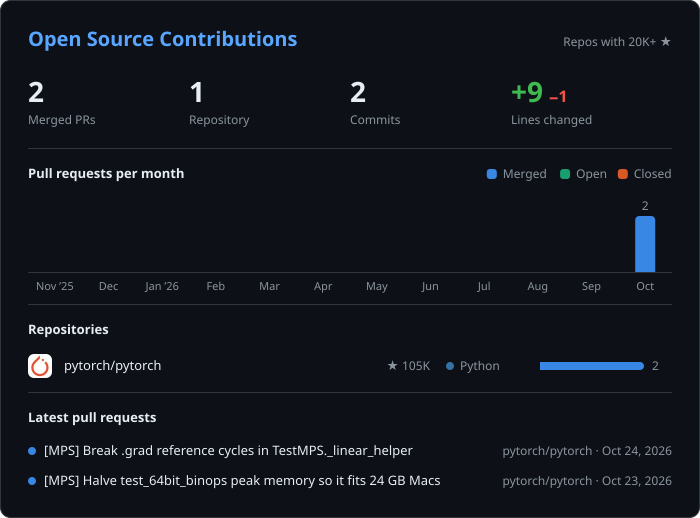

# Hi, I'm Si Yuan 👋

## 🧠 Core Systems

  

- 🏗️ Data Structures & Algorithms (AVL, RB-Tree, Segment Tree, Graphs)
- ⚙️ Systems Design (Distributed, Event-Driven, Microservices)
- 🔄 Concurrency / Multithreading
- 📦 Memory Management & Performance Optimization
- 🔍 Complexity Analysis & Algorithmic Tradeoffs

---

## 🏛️ Backend Engineering

  

- REST / gRPC API Architecture
- Auth Systems (JWT, OAuth2, Session)
- WebSockets / Real-time Systems
- Microservice Decomposition
- Message Queues (Kafka, Redis Streams)
- Load Balancing & Horizontal Scaling

---

## 🌍 Open Source Contributions

<!-- BOARD:START -->

<!-- BOARD:END -->

---

## 🚦 Status Dashboard

---

