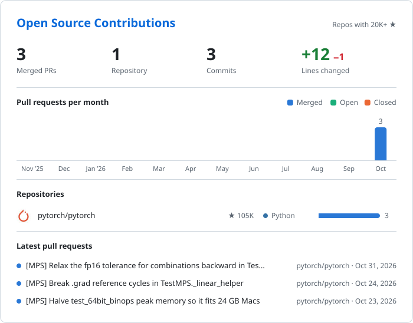
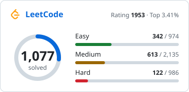
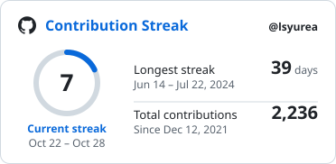

# Hi, I'm Si Yuan 👋

<picture><source media="(prefers-color-scheme: dark)" srcset="assets/header-dark.svg"></picture>

## 🧠 Core Systems

  <picture><source media="(prefers-color-scheme: dark)" srcset="assets/skills/core-dark.svg"></picture>

- 🏗️ Data Structures & Algorithms (AVL, RB-Tree, Segment Tree, Graphs)
- ⚙️ Systems Design (Distributed, Event-Driven, Microservices)
- 🔄 Concurrency / Multithreading
- 📦 Memory Management & Performance Optimization
- 🔍 Complexity Analysis & Algorithmic Tradeoffs

---

## 🏛️ Backend Engineering

  <picture><source media="(prefers-color-scheme: dark)" srcset="assets/skills/backend-dark.svg"></picture>

- REST / gRPC API Architecture
- Auth Systems (JWT, OAuth2, Session)
- WebSockets / Real-time Systems
- Microservice Decomposition
- Message Queues (Kafka, Redis Streams)
- Load Balancing & Horizontal Scaling

---

## 🌍 Open Source Contributions

<!-- BOARD:START -->
<a href="https://lsyurea.github.io/Open-Source/"><picture><source media="(prefers-color-scheme: dark)" srcset="assets/open-source-dark.svg"></picture></a>
<!-- BOARD:END -->

---

## 🚦 Status Dashboard

<a href="https://leetcode.com/u/lsy_urea"><picture><source media="(prefers-color-scheme: dark)" srcset="assets/badges/leetcode-dark.svg"></picture></a>
<a href="https://codeforces.com/profile/lsyurea"><picture><source media="(prefers-color-scheme: dark)" srcset="assets/badges/codeforces-dark.svg"></picture></a>
<a href="https://www.kaggle.com/leesiyuanlsyurea"><picture><source media="(prefers-color-scheme: dark)" srcset="assets/badges/kaggle-dark.svg"></picture></a>

<a href="https://leetcode.com/u/lsy_urea"><picture><source media="(prefers-color-scheme: dark)" srcset="assets/leetcode-dark.svg"></picture></a>
<picture><source media="(prefers-color-scheme: dark)" srcset="assets/streak-dark.svg"></picture>

---

